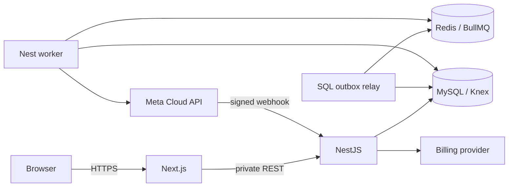

# WaFlow architecture

## Actual stack and requested destination

| Layer | Current executable application | Requested destination |
|---|---|---|
| Web/API | Next.js 16/React 19, NestJS 11, TypeScript | Retain |
| Database | MySQL/mysql2 and Knex | Retain MySQL/Knex |
| Sessions | MySQL node_sessions | Retain |
| Jobs | MySQL node_jobs, polling worker | Redis/BullMQ plus SQL outbox |
| Messaging | Official Meta Cloud API | Retain |
| Billing | Razorpay | Retain configured provider |

MySQL and Knex are the supported persistence stack. Preserve the existing MySQL schema and Knex adapter. Local Compose services do not replace the live schema or restore application data.

Start with one API deployment and one worker entry point sharing services. Avoid microservices. Keep API/SQL/Redis private. SQL owns contacts, permission, recipient state and quota; Redis coordinates work.

## Domain boundaries

Auth owns credentials/session/reset. Workspaces own membership/roles. Contacts own import/normalization/preferences/suppression. WhatsApp owns signup/credentials/templates/Graph transport. Campaigns own review/schedule/recipient expansion/cancellation. Messaging owns intents/window/status transitions. Webhooks own raw signature verification and durable receipt. Billing owns provider subscription and allowances. Operations owns explicit platform access and audits.

Embedded Signup binds state to user/tenant/session, exchanges one-time codes server-side and validates account ownership before encrypting credentials. Provider app review, permissions and allowed origins are external prerequisites. Refer to [Meta's Embedded Signup collection](https://www.postman.com/meta/whatsapp-business-platform/documentation/du6gzjv/embedded-signup).

## Target campaign transaction

Save reviewed template/audience version and outbox event in one SQL transaction. Publish deterministic BullMQ jobs through a relay. Expand recipients in bounded chunks under unique constraints. Before each send recheck current permission, suppression, template/account health and allowance, then atomically claim recipient and reserve usage. Record known provider acceptance or an uncertain result requiring reconciliation. Retrying a job cannot blindly repeat its network send.

Webhook ingress verifies exact raw bytes, resolves stored account and persists a deduplicated event promptly. Workers deduplicate individual messages/statuses and apply nonregressing transitions. Process stop requests before later campaign claims. The outbox recovers queue-publication failures after SQL commit.

## Reliability and scale

Expect at-least-once job delivery. Use SQL uniqueness/conditional updates as correctness authority. Apply bounded exponential retries with jitter to safe transient operations, respect provider rate limits, pace per account and isolate unhealthy tenants. A cancelled campaign cannot retract accepted messages.

Paginate indexed queries, cap file sizes, batch imports/audience expansion and budget pool connections across replicas. Measure SQL latency, queue age and provider errors before adding caches/replicas/partitioning. Multi-replica HTTP limits require a shared store or edge limiter; current in-process limits are not global.

See [database design](DATABASE.md), [roadmap](ROADMAP.md), [API](API.md), [testing](TESTING.md) and [operations](OPERATIONS.md) for migration and release gates.
